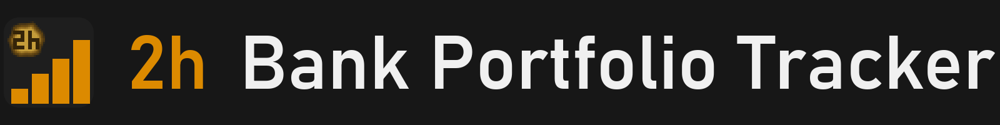
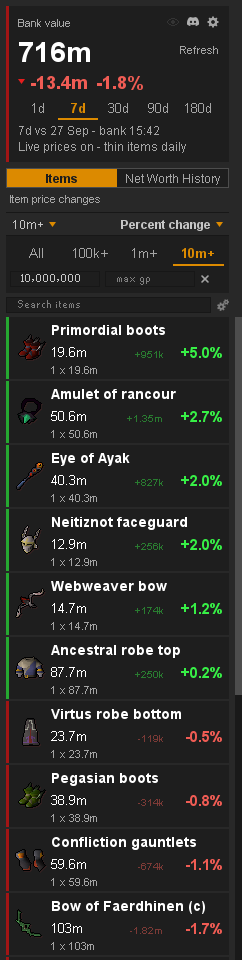
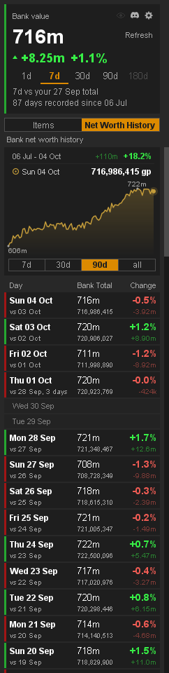

See which of your items are rising or falling, and track your net worth over time.

<table width="100%">
<tr>
<td valign="top">

## What it shows

- **Bank value.** Everything you own and how much it moved over 1, 7, 30, 90 or 180 days.
- **Items.** Every item's worth and its change in gp and %.
- **Net Worth History.** Your total once a day, as a chart and a list.

## Features

- **Counts everything:** bank, inventory, worn items, Grand Exchange offers, coins and bonds. Untradeables made from tradeable items count at their parts' prices.
- **Live prices:** guide prices plus the last 24 hours of trades.
- **Sort, search and filter:** by change, price or stack value; by name; 100k+, 1m+, 10m+ or your own range.
- **Your colours:** presets, including one for colour-blind players, or your own.
- **Streamer mode:** the eye hides every gp amount.
- **No lag while banking:** your bank is read once per visit.
- **Every account apart:** each keeps its own bank and history.
- **Private:** nothing about your account is uploaded.

## Quick start

1. **Open your bank once.** After that it works with the bank closed.
2. **Click an item** to see its exact figures.
3. **Settings icon:** colours, and under *Prices and what counts*, what is counted.
4. **Bonds:** open *Your Bonds* once to count your pouch. A gold dot shows until you do.

</td>
<td width="28"></td>
<td align="right" valign="top" width="235">

 

</td>
</tr>
</table>

 

<table width="100%">
<tr><td colspan="3"></td></tr>
<tr>
<td valign="top">

## Net Worth History

- **A chart of your total**, 7d, 30d, 90d or all. Rest the pointer on the line to read a day.
- **Every day listed**, newest first, with its change.
- **Follows your settings.** Turn coins off and the chart redraws.
- **Moved gold to your other account?** Right-click that day and pick *Sent 200m to my other account* or *Got 200m from my other account*, and the line runs smooth.
- **Start over** with *Reset history*, and undo it with *Restore history*.

</td>
<td width="28"></td>
<td align="right" valign="top" width="235">

 

</td>
</tr>
</table>

---

<strong>Found a bug or have an idea?</strong> Join the <a href="https://discord.gg/nsam4CfWzf">2hBuilds Discord</a>.

Every figure and setting explained: <a href="https://github.com/2hBuilds/bank-portfolio-tracker/blob/main/DETAILS.md">full details</a>.
